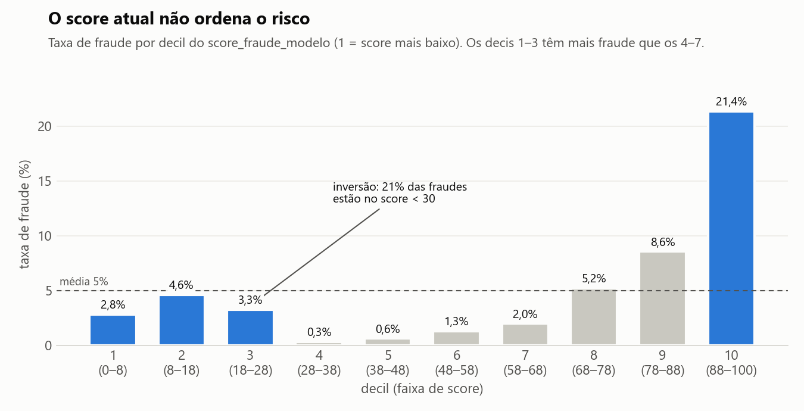

# Detecção de fraude em e-commerce

Estudo de caso de fraude em compras online, desenvolvido ao longo da pós-graduação em Data Science + IA (UNIPDS). Cada etapa aborda o mesmo problema com uma ferramenta diferente.



## Contexto

Base de 150 mil compras de março e abril de 2020, com 5% de fraude. A empresa já usa um modelo que atribui um score de fraude a cada compra. O objetivo é entender o que diferencia uma compra fraudulenta de uma legítima e indicar ao time de risco onde investir: regras, revisão manual ou um novo modelo.

## Etapas

| Etapa | Ferramentas | Status |
|---|---|---|
| [1. SQL: base de modelagem e fatores de risco](#1-sql-base-de-modelagem-e-fatores-de-risco) | SQL, DuckDB | Concluída |
| 2. Python: limpeza e análise exploratória | Python, pandas, Matplotlib, Seaborn | Em andamento |

---

## 1. SQL: base de modelagem e fatores de risco

Construção de uma base de modelagem a partir de seis tabelas cruas, identificação dos fatores de risco e avaliação do score de fraude em uso.

| Arquivo | Conteúdo |
|---|---|
| [`sql/00_carregar_dados.sql`](sql/00_carregar_dados.sql) | Carga dos 6 CSVs e perfil das colunas. Identifica 200 transações de teste e a mesma informação (documento entregue) gravada em três formatos. |
| [`sql/01_abt.sql`](sql/01_abt.sql) | Construção da `abt_fraude`: JOIN 1:1 por `id_transacao` entre transações e scores, com exclusão das transações de teste. São 150.000 linhas e 20 colunas, com as verificações de aceite. |
| [`sql/02_analises.sql`](sql/02_analises.sql) | Taxa de fraude por valor, documentação, horário, país, categoria e canal, e avaliação do score atual por decil. |
| [`reports/recomendacoes.md`](reports/recomendacoes.md) | Análise detalhada e recomendações para o time de risco. |

### Resultados

| Achado | Número |
|---|---|
| A fraude pesa mais no valor do que na quantidade | 5% das transações, 8,4% do valor (R$ 547 mil) |
| Documento recusado é o sinal mais forte | 22% de fraude, contra 5% na média |
| Compras acima de R$ 250 concentram o prejuízo | 2,6% das compras, 49% do valor fraudado |
| O score atual não ordena o risco | A faixa abaixo de 30 tem mais fraude que as faixas intermediárias |
| O corte atual do modelo é pouco preciso | Alerta 48% das compras, com 7,9% de acerto |

Canal de venda e classificação de risco das categorias não apresentam diferença relevante na taxa de fraude.

**Recomendação:** revisão manual das compras acima de R$ 250 com documentação pendente e das compras com score acima de 88. O critério cobre 11% das transações e 59% do valor fraudado. Em paralelo, retreino do modelo com documentação, valor e horário como variáveis.

### SQL utilizado

- `CREATE TABLE AS` com `read_csv_auto` na carga, e `INNER JOIN` 1:1 na montagem da base
- CTEs para organizar as análises em etapas
- Agregação condicional com `FILTER` e `CASE WHEN`
- Window functions: `NTILE` para os decis do score, `RANK` no cálculo da AUC e `SUM() OVER ()` para percentuais do total
- `HAVING` com volume mínimo na comparação entre segmentos
- Validação da tabela final: contagem de linhas, colunas e duplicidade de chave

### Execução

Requer o [DuckDB](https://duckdb.org/docs/installation/).

```bash
# com os CSVs em data/raw/
duckdb fraude.duckdb < sql/00_carregar_dados.sql
duckdb fraude.duckdb < sql/01_abt.sql
duckdb fraude.duckdb < sql/02_analises.sql

# gráficos (opcional, requer duckdb e matplotlib)
python scripts/gerar_graficos.py fraude.duckdb
```

---

## Dados

Os arquivos de dados não estão versionados porque são material do curso. A descrição de cada arquivo está em [`data/README.md`](data/README.md).

## Estrutura

```
sql/                consultas da etapa SQL
notebooks/          notebooks da etapa Python
scripts/            scripts auxiliares (geração de gráficos)
data/
  raw/              dados originais (fora do repositório)
  processed/        dados gerados pelo código (fora do repositório)
reports/
  recomendacoes.md  recomendações para o time de risco
  figures/          gráficos
```

---

Gabriel Henrique Nasatto · [LinkedIn](https://www.linkedin.com/in/gabrielnasatto/)
