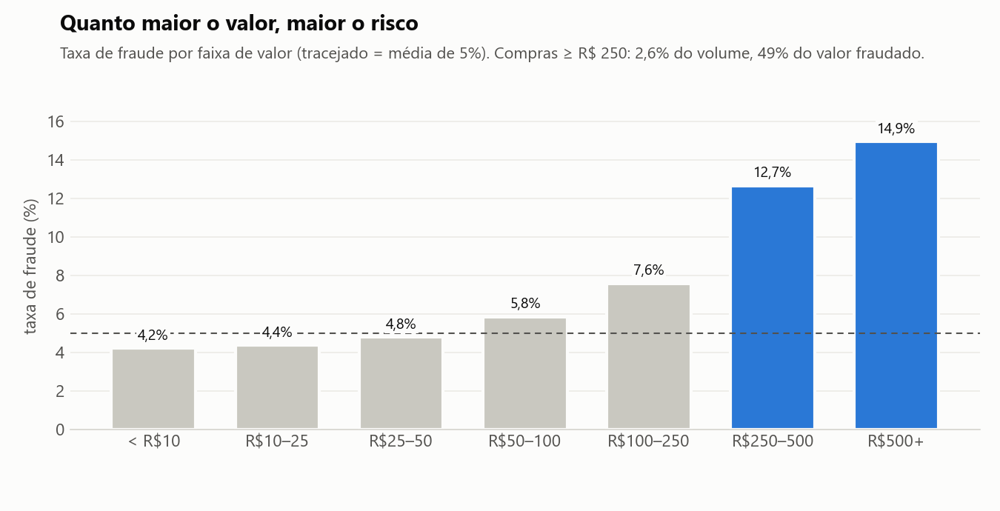
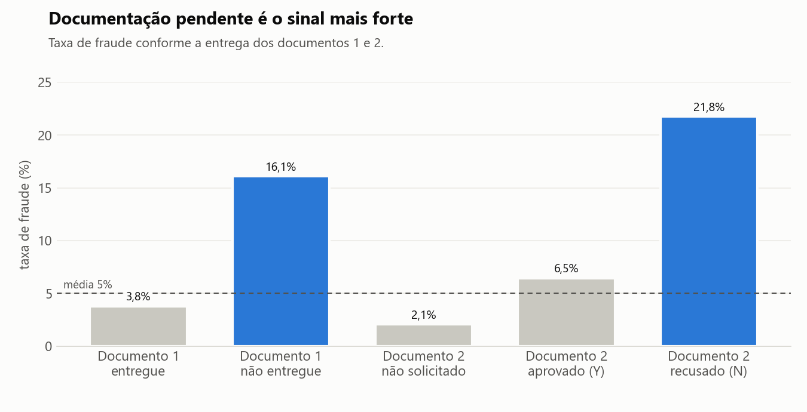
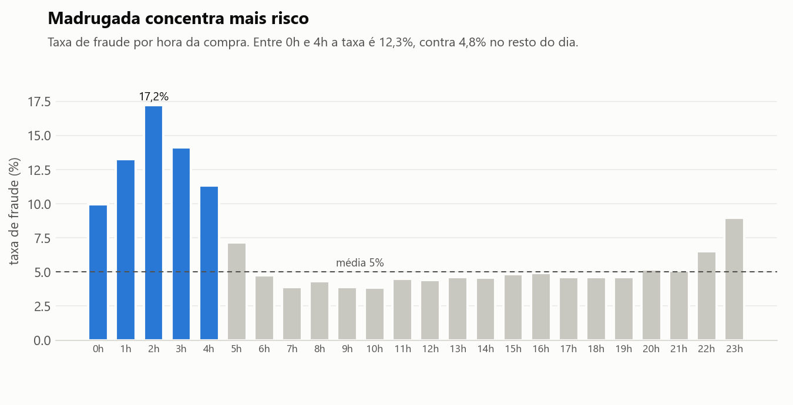

# Recomendações para o time de risco

Base: 150.000 transações de 08/03 a 21/04/2020. Queries em [`sql/02_analises.sql`](../sql/02_analises.sql).

## Tamanho do problema

São 7.500 fraudes (5% das transações), que somam R$ 547 mil, ou 8,4% do valor total vendido. O ticket médio da fraude é R$ 73, contra R$ 42 nas compras legítimas. Por isso a análise considera sempre duas medidas: a taxa de fraude e o valor perdido.

## Concentração da fraude

**Valor da compra.** A taxa cresce com o valor, de 4,2% abaixo de R$ 10 até 15% acima de R$ 500. Compras a partir de R$ 250 representam 2,6% do volume e 49% do valor fraudado.

**Documentação.** A taxa chega a 16% quando o documento 1 não é entregue e a 22% quando o documento 2 é recusado. As compras com alguma dessas pendências somam 62% do valor fraudado.

**Horário.** Entre 0h e 4h a taxa é de 12%, contra 4,8% no restante do dia. Como esse horário responde por apenas 3% do volume, é mais útil como variável do modelo do que como regra isolada.

**Sem diferença relevante:**
- Canal de venda: todos os canais ficam entre 4,9% e 5,1%.
- Classificação de risco das categorias: o risco "alto" tem 5,1% de fraude e o "baixo", 4,7%. O cadastro precisa de revisão.
- País: com volume mínimo de 1.000 transações, Brasil 5,5%, Argentina 3,7% e Uruguai 1%. Os países no topo do ranking sem esse filtro têm menos de 10 transações.

## Avaliação do score atual

A base foi dividida em 10 faixas pelo `score_fraude_modelo`. Se o score funcionasse, a taxa de fraude cresceria a cada faixa, mas isso não acontece. As três faixas mais baixas (score de 0 a 28) têm entre 2,8% e 4,6% de fraude, acima das faixas intermediárias, que ficam entre 0,3% e 2%. Como resultado, 21% das fraudes têm score abaixo de 30.

O corte atual (score a partir de 50) marca 48% das compras, com acerto de apenas 7,9%. A AUC de 0,73 não revela essa inversão. A única faixa confiável é a mais alta (score a partir de 88), com 21% de fraude e 43% de todas as fraudes.

## Recomendações

**1. Revisão manual imediata** das compras que atendem a um dos critérios:
- valor a partir de R$ 250 com documentação pendente;
- score a partir de 88.

| | Corte atual | Proposta |
|---|---|---|
| Compras revisadas | 48,5% | 10,9% |
| Acerto | 7,9% | 21,2% |
| Fraudes capturadas | 76% | 46% |
| Valor fraudado capturado | n/d | 59% |

O volume estimado é de cerca de 360 revisões por dia. Caso exceda a capacidade do time, a prioridade são as compras de valor alto com documentação pendente: 888 casos, com 38% de fraude e 32% do valor perdido.

**2. Retreino do modelo** com documentação, valor e horário como variáveis, validado faixa a faixa e não apenas pela AUC.

**3. Correções na origem dos dados:** padronização do formato dos documentos, preenchimento das 194 transações sem país e revisão da classificação de risco das categorias.

## Limitações

O período é curto (6 semanas). As taxas por segmento são descritivas, então o efeito isolado de cada sinal deve ser confirmado na modelagem.
